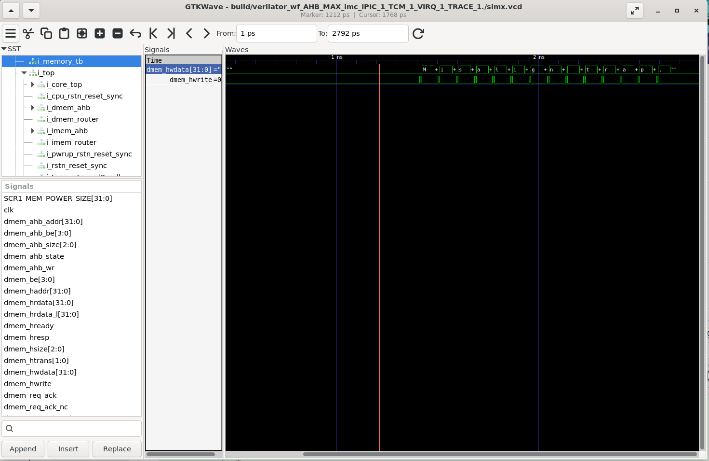

# Лабораторная работа 2

- Выполнил: Цалов В.С.
- Группа: P4130

## 1. Цель
Ознакомиться с возможностями настройки архитектуры системы команд,
обработкой исключений/прерываний и принципами работы сборщика
программ.

## 2. Задание
1. Необходимо добавить копию репозитория SCR1 https://github.com/syntacore/scr1 в ваш личный аккаунт на GitHub (который вы заводили
для предыдущих лабораторных). Это будет ваш рабочий репозиторий, в
котором вы сможете делать любые изменения с проектом. Копирование
производится командой fork https://help.github.com/en/articles/fork-a-repo .
2. В репозитории создать ветку с именем lab_scr1_sim. В этой ветке вы
будете коммитить все изменения проекта для данной лабораторной.
Убедитесь, что проект собирается и все тесты проходят в симуляции
до внесения изменений в проект. В качестве программы-симулятора
мы рекомендуем использовать Verilator, но по желанию вы можете
использовать любую из поддерживаемого списка.
3. Отредактировать список тестов, чтобы на выполнение остался только
тест по варианту задания. Как выбрать отдельные тесты для симуляции
описано в SCR1 User Manual, раздел 5.2. Test subset. Запустить
симуляцию для Verilator и убедиться, что проходит только выбранный
тест.
4. В соответствии с вариантом задания модифицировать обработку
исключений trap_vector в файле ./sim/tests/common/riscv_macros.h
5. Установить в файле ./src/includes/scr1_arch_description.svh параметры
ядра Reset Vector и Trap Vector в соответствии с вариантом задания.
6. Изменить linker-скрипт ./sim/tests/common/link.ld и участвующие в сборке файлы программы для корректного запуска теста с новыми значениями Reset Vector и Trap Vector.
7. Сохранить в директории ./results: результат симуляции (test_results.txt),
дизассемблер теста (*.dump), трейс лог MPRF (trace_mprf_diff_.log),
трейс лог CSR (trace_csr_.log).

8. Создать в директории ./lab_scr1_sim файл с отчетом по проделанной
README.md.

9. Закоммитить все произведенные изменения в ветке lab_scr1_sim.

## Вариант
|№|Вид исключения|Тест|Reset vector|Trap vector|Обработчик|
|-|-|-|-|-|-|
|11|Instruction address misaligned|isa/rc32mi/ma_fetch.S|0x200|0x400|Вывод строки "Misalign trap"|

## Ход работы
### 1. Отключаем лишние тесты

Меняем в файле [sim/tests/riscv_isa/rv32_tests.inc](../sim/tests/riscv_isa/rv32_tests.inc) тесты на 

```
rv32_isa_tests += isa/rv32mi/ma_fetch.S
```

В [Makefile](../Makefile) комментируем строки вида

```
TARGETS += ...
```

кроме `TARGETS += riscv_isa`

### 2. Добавляем свой обработчик (Breakpoint)
В файл [sim/tests/common/riscv_macros.h](../sim/tests/common/riscv_macros.h) дописываем около 120 строки (в функции trap_vector)

```
    li a5, CAUSE_MISALIGNED_FETCH;                                  
    beq a4, a5, misalign_handler;                                   
```

тем самым проверем источник прерывания. При наступлении misaligned fetch, происходит переход в функцию misalign_handler:

```
misalign_handler:                                                       \
        lui a6, 0xf0000;                                                \
        la a7, MSG;                                                     \
next_iter:                                                              \
        lb a5, 0(a7);                                                   \
        beq a5, x0, break_from_loop;                                    \
        sw a5, 0(a6);   /* write to a6 char for print */                \
        addi a7, a7, 1;                                                 \
        jal x0, next_iter;                                              \
break_from_loop:                                                        \
        j sc_exit;                                                      \
```
это функция, выводящая содержимое строки MSG, объявленой ранее как 

```
MSG:.string "Misalign trap\n";                                          \
```

в результате в [results/sim_results.txt](../results/sim_results.txt) видно, что при выполнении теста вывелась именно эта строка

### 3. Меняем положение reset_handler и trap_handler

В файле [src/includes/scr1_arch_description.svh](../src/includes/scr1_arch_description.svh) меняем строки с определением SCR1_ARCH_RST_VECTOR и SCR1_ARCH_MTVEC_BASE на

```
parameter bit [`SCR1_XLEN-1:0] SCR1_ARCH_RST_VECTOR = 'h200;
parameter bit [`SCR1_XLEN-1:0] SCR1_ARCH_MTVEC_BASE = 'h400;
```

Поменяем расположение соответствующих символов в исполняемом файле. Для этого вынесем символы векторов в отдельные секции в файле [sim/tests/common/riscv_macros.h](../sim/tests/common/riscv_macros.h) (искать ".text.start" и ".text.trap") и расположим секции в определенные места в памяти с помощью linker скрипта [sim/tests/common/link.ld](../sim/tests/common/link.ld)

```
.text.start 0x200 : {
    *(.text.start)
} >RAM

.text.trap 0x400 : {
    *(.text.trap)
} >RAM

```

Корректность расположения можно увидеть просмотром дампа [results/ma_fetch.dump](../results/ma_fetch.dump)

```
...текст
00000200 <_start>:
...текст
00000400 <trap_vector>:
...текст
```

### Логи

Вывод сообщения "Misalign trap"


